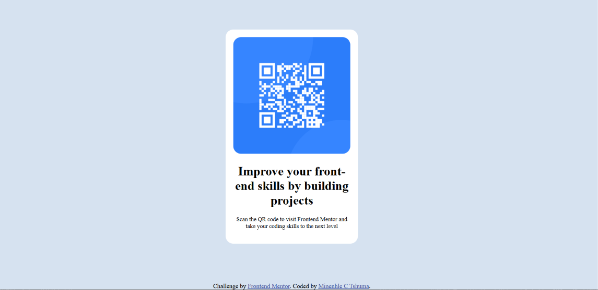

# Frontend Mentor - QR code component solution

This is a solution to the [QR code component challenge on Frontend Mentor](https://www.frontendmentor.io/challenges/qr-code-component-iux_sIO_H). Frontend Mentor challenges help you improve your coding skills by building realistic projects. 

## Table of contents

- [Overview](#overview)
  - [Screenshot](#screenshot)
  - [Links](#links)
- [My process](#my-process)
  - [Built with](#built-with)
  - [What I learned](#what-i-learned)
  - [Continued development](#continued-development)
  - [Useful resources](#useful-resources)
- [Author](#author)

**Note: Delete this note and update the table of contents based on what sections you keep.**

## Overview

### Screenshot



### Links

- Solution URL: [Add solution URL here](https://your-solution-url.com)
- Live Site URL: [Add live site URL here](https://your-live-site-url.com)

## My process

### Built with

- Semantic HTML5 markup
- CSS custom properties
- vs code 

### What I learned

I learnt how to link my stylesheet with HTML, i do hope that as i continue learning, my code and way of saving my files will meet higher standards.

```html
<link rel="stylesheet" href="stylesheet.css">
```

### Continued development

I am yet to continue learning HTML,CSS and Js as a beginner, for now i want to focus on the syntx so that my code will be clear to read and neat.


### Useful resources

- [Resource 1](https://www.w3schools.com) - This online school helped me learn the basics of HTML and CSS.


## Author

- Website - [Add your name here](https://www.your-site.com)
- Frontend Mentor - [@mtshuma16-crypto](https://www.frontendmentor.io/profile/mtshuma16-crypto)


